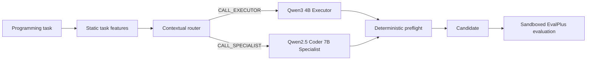

# HeteroAgent-RL

**Learning which LLM should handle a task instead of treating every request the same way**

Modern AI systems increasingly have access to multiple language models. Some models are small and general-purpose, while others are larger or specialized for tasks such as coding. A common approach is to always use the strongest model or to run several agents for every request.

Both approaches can be inefficient.

A simple task may not need a specialized model, while a harder programming problem may benefit significantly from one. Calling planners, verifiers, repair agents, or multiple models for every request also increases latency and resource use.

**HeteroAgent-RL explores whether an AI system can learn to choose the right local LLM for each task before generation begins.**

The final system extracts inexpensive characteristics from a programming problem and uses a lightweight learned router to choose between a general-purpose model and a coding specialist.

```text
Programming task
        ↓
Static task features
        ↓
Learned router
      ↙       ↘
 General     Coding
 Executor   Specialist
      ↘       ↙
       Solution
```

The goal is not to build another large multi-agent framework. The goal is to study **adaptive inference** — using different models where they are most useful instead of applying the same model or workflow to every request.

## Why this matters

Real AI systems often operate with models that differ in capability, specialization, memory requirements, latency, and inference cost.

A routing layer can decide which model should handle a request before paying the cost of generation. This idea can be useful in coding assistants, local and edge AI systems, enterprise inference gateways, agent systems with specialized workers, and cost-aware AI services that need to balance quality against compute.

HeteroAgent-RL focuses on programming tasks because they provide objective executable evaluation, but the routing problem is broader. The same design idea could apply to systems choosing among general models, reasoning models, domain specialists, multimodal models, or models deployed on different hardware.

## What this project investigates

HeteroAgent-RL asks one concrete question

> **Can we predict which local LLM is most suitable for a programming task before running it?**

The project compares a general-purpose local LLM with a coding-specialized LLM, measures where their capabilities overlap and differ, and trains a lightweight contextual router using task-level features available before inference.

The final result is not that routing always beats the strongest model. Instead, the experiments show that the models have complementary strengths, that routing decisions can be learned from task features, and that a learned router can recover most of the available two-model oracle performance without running both models for every task.

## Final result

On the untouched 25-task HumanEval+ test split, the learned router reached the same strict correctness as the stronger fixed specialist and substantially outperformed the general-purpose Executor.

| Method | Base pass | Strict EvalPlus+ | Tokens | LLM latency | Avg policy reward |
| --- | ---: | ---: | ---: | ---: | ---: |
| Executor only | 84% | 76% | 12,790 | 123.9 s | 0.7445 |
| Specialist only | 92% | 92% | 11,156 | 135.9 s | 0.9041 |
| Learned router | 92% | 92% | 11,850 | 161.1 s | 0.9031 |
| Two-model oracle | — | 96% | — | — | — |

The two underlying models were complementary on the final test set. Eighteen tasks were solved by both models, five only by the Specialist, one only by the Executor, and one by neither. The learned router made the correct model choice on all but one routable task.

The router did not beat the Specialist on the final test set. It tied the Specialist at 92% strict correctness while using slightly more tokens and latency. That result is reported as observed rather than tuned away.

## Final architecture



The router sees only inexpensive prompt-derived features available before inference. It never sees held-out EvalPlus results when choosing a model.

## Design rationale

Early baselines compared larger multi-agent workflows with simpler direct-generation systems. Extra Planner, Verifier, and Repairer calls did not consistently improve correctness enough to justify their added cost.

The final design therefore focuses on heterogeneous model routing. A small controller chooses between two models with different strengths before generation, which keeps the deployed workflow simple while still exploiting model specialization.

The final controller is intentionally lightweight. A shallow decision tree is trained from paired model trajectories using static task features. Training uses policy reward so correctness dominates while token and latency costs can break ties.

## Models

The default local setup uses

| Role | Model |
| --- | --- |
| General Executor | `qwen3:4b-instruct` |
| Coding Specialist | `qwen2.5-coder:7b-instruct` |

Both run locally through Ollama.

## Benchmark protocol

HumanEval tasks 0 through 24 were reserved as legacy development data because they had been repeatedly inspected during early experimentation.

The remaining 139 HumanEval tasks are split deterministically with seed `heteroagent-rl-clean-v1`

| Split | Tasks | Purpose |
| --- | ---: | --- |
| Train | 90 | Router training and model complementarity analysis |
| Dev | 24 | Frozen-policy validation |
| Test | 25 | Final untouched reporting |

The clean test split was not used for prompt changes, model selection, router training, feature engineering, or hyperparameter selection.

## Development results

The two fixed models already showed useful complementarity on the clean training split.

| Train metric | Executor | Specialist | Oracle |
| --- | ---: | ---: | ---: |
| Strict EvalPlus+ | 78.89% | 80.00% | 88.89% |

The learned router was trained only from those 90 paired trajectories.

On the 24-task clean dev split

| Method | Strict EvalPlus+ |
| --- | ---: |
| Executor | 83.33% |
| Specialist | 91.67% |
| Learned router | 95.83% |
| Oracle | 95.83% |

The live end-to-end dev run reproduced the cached 95.83% router result.

## Router

The router uses the static feature schema already recorded by the environment

```text
prompt length
line count
word count
function count
helper-function count
import count
visible example count
argument count
annotation count
varargs and kwargs flags
parse status
```

Training performs training-only cross-validation over a small fixed decision-tree grid. The selected policy has maximum depth 2 and minimum leaf size 8.

The frozen policy used for the reported dev and test evaluations has SHA-256

```text
01428874602c7f5f02dd8cd59300b5d774b3452f0d225aa806a2f9591af9bb65
```

Although many features are available, the final tree happened to use normalized prompt length. That is an empirical outcome of this dataset, not a hand-written benchmark rule.

## Reward

The environment optimizes correctness first while penalizing unnecessary resource use.

```text
terminal correctness
- LLM call cost
- token cost
- LLM latency cost
- tool call cost
- tool latency cost
- invalid action penalty
```

Held-out correctness is used only for terminal evaluation and offline training labels. It is never exposed as an online routing signal.

## Sandboxed execution

Generated code is evaluated outside the host Python process.

Supported backends include Apple `container` and Docker. The project disables network access inside the evaluation sandbox and applies resource limits where supported.

The Apple container backend was used for the reported final experiments.

## Quick start

Install the project and local models

```bash
python -m venv .venv
source .venv/bin/activate
pip install -e ".[bench,dev,router]"

ollama pull qwen3:4b-instruct
ollama pull qwen2.5-coder:7b-instruct

pytest -q
```

Generate the two clean training baselines

```bash
python -m heteroagent_rl.rl.evaluate_baselines \
  --benchmark humaneval \
  --split train \
  --controller executor_only \
  --fresh

python -m heteroagent_rl.rl.evaluate_baselines \
  --benchmark humaneval \
  --split train \
  --controller specialist_only \
  --fresh
```

Train the contextual router

```bash
python -m heteroagent_rl.rl.train_router
```

Score it against cached dev trajectories without new model calls

```bash
python -m heteroagent_rl.rl.score_router
```

Run the router end to end on the clean dev split

```bash
python -m heteroagent_rl.rl.evaluate_baselines \
  --benchmark humaneval \
  --split dev \
  --controller learned_router \
  --router-policy runs/router/humaneval/contextual_tree.json \
  --fresh
```

## Repository structure

```text
src/heteroagent_rl/
  agents/            role-specific LLM agents
  benchmarks/        EvalPlus loading and clean splits
  clients/           Ollama and optional hosted backends
  rl/                environment, controllers, router, rewards, checkpoints
  sandbox/           isolated code execution

tests/               unit and regression tests
docs/                experiment history and final results
results/             frozen machine-readable final result summary
```

## What this project demonstrates

HeteroAgent-RL is primarily an engineering portfolio project. It demonstrates reproducible LLM evaluation, local inference, heterogeneous model orchestration, task-aware routing, sandboxed code execution, explicit cost accounting, clean train-dev-test methodology, checkpointed experiments, and evidence-driven system simplification.

The central lesson is that orchestration complexity should earn its cost. Planner and Verifier calls were not kept simply because multi-agent systems often contain them. The final design is smaller because the experiments supported a smaller design.

## Limitations

The reported benchmark is HumanEval+, the final test set contains only 25 tasks, and each reported model run uses a single local generation. Ollama generation is stochastic, so some task-level variation is expected across independent reruns.

The final router is also deliberately lightweight. It does not use semantic embeddings, model confidence, candidate inspection, or sequential escalation. Those are reasonable future research directions, but they are outside the scope of the finished portfolio project.

## Project status

The experimental system is complete.

The frozen final comparison is Executor versus Specialist versus learned contextual router on the untouched HumanEval+ test split. No additional test-set tuning is part of the reported project.

For the experimental progression and negative results, see `docs/EXPERIMENTS.md`.

For the final benchmark record, see `docs/RESULTS.md` and `results/final_test_summary.json`.
